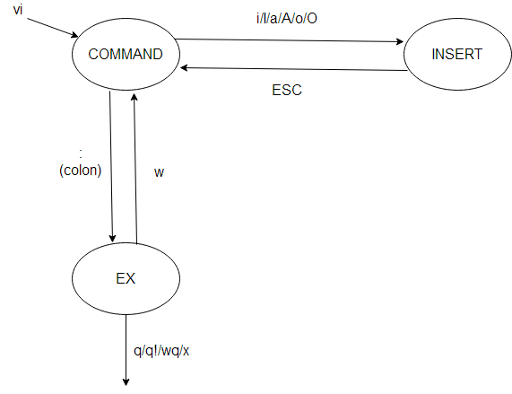

# Vim

## Modes
- **`ESC`**: Normal mode. For moving around a file; reading; going to file to file
- **`i`**: Insert mode. For inserting text
- **`:`**: Command-line mode. For running a command
- **`r`**: Replace mode. For replacing text
- **`v`**: Visual mode. For selecting blocks of text
- **`SHIFT` + `v`**: Visual line mode
- **`Ctrl` + `v`**: Visual block mode

## Command-line

Command mode can be entered by typing `:` in Normal mode. Your cursor will jump
to the command line at the bottom of the screen upon pressing `:`. This mode
has many functionalities, including opening, saving, and closing files, and
[quitting Vim](https://twitter.com/iamdevloper/status/435555976687923200).

- `:q` quit (when no modifications are made)
- `:q!` quit and discard changes
- `:w` write (save)
- `:wq` write and quit
- `:e {name of file}` open file for editing
- `:ls` show open buffers
- `:help {topic}` open help
    - `:help :w` opens help for the `:w` command
    - `:help w` opens help for the `w` movement

## Predefinied colors/themes
1. Download a theme 
   - https://raw.githubusercontent.com/tomasr/molokai/master/colors/molokai.vim
2. Placed it in `~/.vim/colors/`
   - `mv molokai.vim ~/.vim/colors/`
3. Activate the them with the command `colorscheme molokai`
4. You can find other colors themes in /usr/share/vim/vim*/colors/

## Custom Colors/Themes

http://vimcasts.org/episodes/creating-colorschemes-for-vim/

#### RGB or 256 colors ?
" https://stackoverflow.com/questions/44164518/themes-in-iterm-change-colours-in-vim
" https://sts10.github.io/2016/06/15/true-hex-colors-in-vim-with-iterm2.html
- RGB colors `set termguicolors`
- 256 colors `set t_Co=256`

####  Examples
- Only using `hi` (`highlighth`) and links
  - https://stackoverflow.com/questions/26958070/how-do-i-link-highlighting-groups-in-a-vim-colour-scheme
  - https://stackoverflow.com/questions/2444072/defining-a-color-variable-in-vim
  - https://gist.github.com/amaxwell01/4028475
  - https://gist.github.com/silenc3r/d2fe3750ac9ae8ce1d1817c4fa52921c
  - https://opensource.apple.com/source/vim/vim-53/runtime/colors/koehler.vim.auto.html
- Using variables (`hi` + `execute`)
  - https://stackoverflow.com/questions/2444072/defining-a-color-variable-in-vim
  - https://github.com/vim-scripts/bandit.vim/blob/master/colors/bandit.vim

## NeoVIM

- NvimTreeToogle: left tree panel
- nvchad